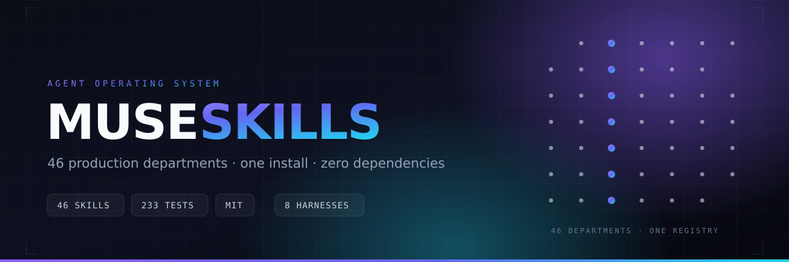
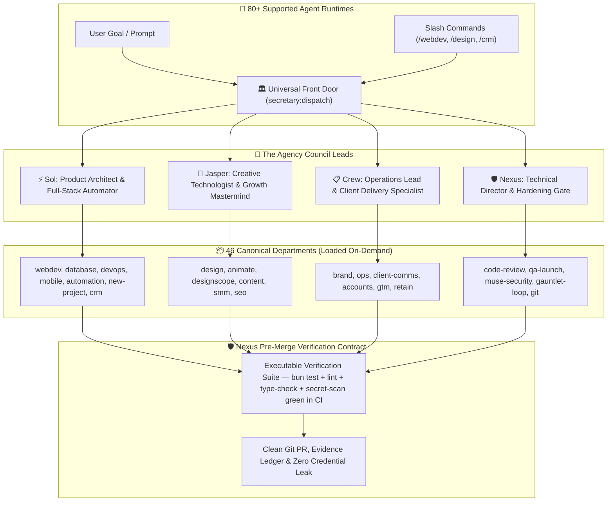

<div align="center">



# 🏛️ Muse Skills

**Production-grade skills for AI coding agents. Turn any coding assistant into an autonomous senior engineering team and full-service digital agency with persistent context, automated verification gates, and zero external dependencies.**

[](https://opensource.org/licenses/MIT)
[](https://github.com/harshsinghmp/muse-skills/releases)
[](#-complete-skill-catalog)
[](.github/workflows/ci.yml)
[](#-runtime-compatibility)

</div>

```bash
# ⚡ Option A: Quick Install (Agent Natural Language Discovery)
npx skills add harshsinghmp/muse-skills

# 🚀 Option B: Instant Remote Setup (46 Skills + 462 Slash Commands Per Harness — No Clone Needed)
curl -fsSL https://raw.githubusercontent.com/harshsinghmp/muse-skills/v8.6.1/scripts/install.sh | bash

# 🛠️ Option C: Manual Setup (From Source)
git clone https://github.com/harshsinghmp/muse-skills.git && cd muse-skills && bun run setup
```

---

## 🆕 What's New

- **Routing gates that admit uncertainty** (v8.6.0): near-tie departments are reported instead of guessed, two fast-path rules were narrowed to match intent rather than vocabulary (Expo no longer routes to the generic mobile mode), installers resolve the latest release by default, and a release workflow bug can now be repaired without moving a published tag.
- **Routing gates you can audit** (v8.5.0): the routing matrix runs as its own CI job and the README publishes every measured distribution — the 65% tuned row beside the blind sets at 2.5–7.5% — plus the real coverage split (134 of 406 modes carry a curated signal, 272 are name/description only). A sixth blind set (v9) is gated at its honest score, and the landing gate no longer counts its own earlier runs.
- **v8.4.2 release hygiene** (v8.4.2): dependency and docs-ledger gates, a weekly dependency-refresh tracker, a fully backfilled agent watermark, and a 40s parallel suite after the scaffold-test batching.
- **v8.4.1 follow-ups** (v8.4.1): the lockfile audit accepts a project directory, CI gained a dedicated boundary/EDR/lockfile security job, issue labels and a distribution-path threat model are documented, dependencies and the docs ledger are refreshed, and every published release now gets an automatic checksum-pinned smoke check.
- **Security wave 3, skill-quality gates & faster CI** (v8.4.0): the 2026-11-09 security audit's remaining waves land — honest receipts instead of fabricated client claims, integer money math, producer-ID metering with clamped invoices, fail-closed CI/secret scanning, a pinned installer with a release checksum, constant-time review tokens, HMAC-verified webhook scaffolds, and SSRF-safe fetchers. All 46 skills now pass a discovery-surface parity gate (`bun run check:surface`); the import-guard suite covers `updatedocs`, `new-project`, `tunnel`, and `sample-size`; and CI runs the 693-test suite in parallel (≈48s vs ≈89s) with package-tarball caching and superseded-run cancellation.
- **Release safety & agent follow-ups** (v8.3.0): `updateagents` is entry-point gated so importing it never runs a sync or rewrites curated standards; the generated `AGENTS.md` ends highly technical work with a prioritized **Next 3** follow-up block; the three-scenario agency simulation now covers all 46 skills and gates releases; and CI caches and pins Bun to end release-asset `504` failures.
- **Universal pre-merge sync gate** (v8.2.0): every scaffolded project now ships a self-contained `sync-gate.yml`; `updateagents --refresh-workflows` updates existing copies. The English-only policy also binds narration between tool calls, and URL intake is documented in the root router.
- **Session-proof docs + clean agent roots** (v8.1.0): `updatedocs` now keeps a `.docs-ledger.json` point ledger with developer/user/agent coverage, shipped state, what's-new generation, and a post-commit capture hook (`DOCS-LEDGER.md`); `updateagents` consumes completed points with `--docs-backlog` and enforces clean roots with `--hygiene`, active-harness skip, `harness-hygiene-session.sh`, `harness-hygiene-pre-commit.sh`, `harness-hygiene-pre-push.sh`, and local-only `.git/info/exclude` patterns (`gitignore.private.template`). `new-project` now runs a five-section client onboarding and renders every intake document from real answers.
- **Engine upgrades scaffolded into every new project** (v7.7.0): derived-artifact release invariant (bump ⇄ regenerate ⇄ `--check` gate) + `{{integration_branch}}`/`{{production_branch}}` branch placeholders, auto-provisioned `landing-gate.yml` CI, **SHA-pinned GitHub Actions** in every scaffolded workflow, and a hardened installer (no `eval`, arg-array spawn everywhere).
- **New operational standards** (v7.6.0): **Landing Gate** — `bun run check:landed`, LANDED/LOCAL verdicts, delivery is not commitment; **Test-Failure Audit** — self-triage before fixing on repeated red; **Session Report Protocol** — technical report, then a plain-language Layman Report appendix (user-facing only), plus a prioritized **Next 3** follow-up block for highly technical work.
- **Command surface**: 46 skills + 406 `<skill>-<mode>` commands + 10 aliases = **462 slash commands per harness**, plus `<skill>-<file>` support-reference commands on 20 skills.
- **muse-security 1.1.0**: its audit mode integrates the OWASP LLM Top 10 **2026 edition** and the OWASP **Top 10 for Agentic Applications**, with runtime-vs-build-time control attribution and ephemeral zero-trust mTLS subagent attestation.
All verified by the CI suite (`bun test` + lint + type-check + secret-scan). See the [Full Changelog](CHANGELOG.md) or explore all [GitHub Releases](https://github.com/harshsinghmp/muse-skills/releases).

---

## 🧭 Overview

**Muse Skills** transforms vanilla AI coding assistants into an autonomous, senior full-service engineering team and digital agency. Built on the open `SKILL.md` RFC specification, it injects 46 production-grade departments—spanning full-stack engineering, motion design, growth hacking, client operations, and rigorous quality auditing—directly into your agent harness with zero runtime bloat, zero API lock-in, and zero credential leakage.

Unlike brittle system prompts or heavy wrapper frameworks, Muse Skills enforces **Progressive Disclosure**: agents read only what they need, execute structured mode playbooks, and verify every single claim against executable tests before declaring work complete.

Every skill follows the open `SKILL.md` specification: rich intent triggers, step-by-step procedures, failure recovery routines, and automated verification tests. Your agent reads only what it needs, when it needs it, and verifies every claim before reporting success.

---

## ⚡ Why Muse Skills?

| Challenge with Vanilla AI Agents | The Muse Skills Advantage |
| :--- | :--- |
| **Prompt Fatigue & Manual Routing**: Users must remember exact prompts, sub-skills, or paths for every task. | **Universal Central Dispatch**: `secretary:dispatch` automatically inspects user intent on session start, maps to the right Council Lead (**Sol**, **Jasper**, **Crew**, **Nexus**), and routes to the exact mode playbook. |
| **Context Amnesia**: Agents lose track of architecture, conventions, and past decisions between sessions. | **Persistent Cognitive Context**: `context-anchor` and `updateagents` preserve project truth, active constraints, and architectural invariants indefinitely. |
| **Premature Victory**: Agents claim code works without running real tests, leaving broken builds behind. | **Automated Verification Gates**: Every workflow enforces executable test commands (`bun test`, `pytest`) before sign-off (Evidence over Claims). |
| **Chaotic Releases**: Unformatted commits directly to production branches cause merge conflicts and regressions. | **Disciplined Release Flow**: The `git` skill automates semantic versioning, feature branches, and tag creation seamlessly. |
| **Harness Fragmentation**: Custom commands work in one IDE or CLI but break in another. | **Multi-Harness Slash Commands**: Instant native commands across OpenCode, Claude Code, Codex, Cursor, Windsurf, Copilot, Continue, Roo Code, Qwen Code, and Antigravity — plus `SKILL.md` that agents like Amp read directly. |
| **Messy Client Handoffs**: Scattered requirements, manual onboarding, and accidental credential leaks. | **End-to-End Agency Operations**: Dedicated skills for `brand` intake, `client-comms`, `accounts`, and `qa-launch` with zero credential leakage. |

---

## 📐 System Architecture

Muse Skills operates on a **Progressive Disclosure** and **Autonomous Council Dispatch** model. Agents maintain a lean, lightweight context footprint by loading modular skills on demand, executing structured mode handlers, and validating outcomes through deterministic checks.



<details>
<summary><b>🔍 View Architectural Details & Runtime Specification (Click to expand)</b></summary>
<br/>

### 1. The Skill Contract (`SKILL.md`)
Each skill is completely self-contained within its own directory:
- **YAML Frontmatter**: Declares canonical name, trigger-rich description, argument hints, and tool prerequisites.
- **Trigger Index**: Maps natural language user requests to specific execution modes.
- **Reference Playbooks (`references/*.md`)**: Loaded selectively so agents consume only relevant instructions without exceeding context limits.
- **Verification Scripts (`scripts/*.ts`)**: Fast CLI utilities that programmatically audit deliverables, score readiness, and enforce standards.

### 2. Zero-Dependency Portability
- **Pure Markdown & Modern CLI**: Written in vendor-neutral Markdown and standards-compliant shell/TypeScript.
- **Cross-Platform**: Operates identically across Linux, macOS, and Windows.
- **Universal Agent Support**: Compatible with Claude Code, Codex, Cursor, OpenCode, Google Antigravity, Amp, Qwen Code, Copilot, Continue, Roo Code, and any runtime implementing the standard skills protocol.

### 3. Verification Doctrine (Evidence Over Claims)
- No agent may claim completion without running executable proof commands.
- All code changes are validated against real tests, lint checks, and secret scans before commits are staged.
</details>

---

## 💼 Core Agency Divisions

Muse Skills organizes 46 specialized capabilities into four internal agency divisions:

### 1. 🏗️ Engineering & System Architecture
High-performance application development, database design, and cloud infrastructure.
- **Web & Full-Stack**: Complete web applications with Next.js, Astro, and clean component patterns ([`webdev`](skills/agency-delivery/webdev/README.md)).
- **Interactive Project Creation**: 6-stage scaffolding engine with framework, styling, and database wiring ([`new-project`](skills/core-engine/new-project/README.md)).
- **Full-Stack Refactoring**: 20-mode engine for cleaning legacy code, architecture, and query optimization ([`refactor`](skills/design-interface/refactor/README.md)).
- **Modern Infrastructure**: Cloudflare Workers, Pages, Zero Trust tunnels, and automated CI/CD pipelines ([`devops`](skills/agency-delivery/devops/README.md)).
- **Mobile Development**: Native cross-platform workflows with Expo and Capacitor ([`mobile`](skills/agency-delivery/mobile/README.md)).
- **Database Operations**: Query tuning, migrations, connection pools, and ORM schemas ([`database`](skills/agency-delivery/database/README.md)).

### 2. 🎨 Creative Design, UI/UX & Motion
Award-winning user interfaces, design systems, and rich interactive web experiences.
- **Design Systems & UI Kits**: Design tokens, component primitives, responsive layouts, and CRO patterns ([`design`](skills/agency-delivery/design/README.md)).
- **Unified Motion & 3D**: Three.js WebGL scenes, interactive canvas shaders, and smooth GSAP choreography ([`animate`](skills/design-interface/animate/README.md)).
- **Design System Extraction**: Reverse-engineer design tokens and component catalogs from existing websites ([`designscope`](skills/design-interface/designscope/README.md)).
- **Natural Copywriting**: Humanize AI drafts and apply battle-tested copywriting formulas ([`humanize`](skills/quality-review/humanize/README.md), [`content`](skills/agency-delivery/content/README.md)).

### 3. 📈 Growth, Marketing & Operations
End-to-end client acquisition, content generation, and agency delivery workflows.
- **CRM & Automated Flows**: Audience segmentation, RFM scoring, welcome drips, cart recovery, and deliverability infrastructure ([`crm`](skills/agency-delivery/crm/README.md)).
- **Brand & Client Lifecycle**: Client intake briefs, secure credential delegation, and offboarding ([`brand`](skills/agency-delivery/brand/README.md)).
- **Organic Social & Video**: Social listening, viral content hooks, and multi-platform publishing ([`smm`](skills/agency-delivery/smm/README.md)).
- **Search & AI Discovery (SEO/AEO)**: Keyword clustering, semantic search optimization, and AI answer engine readiness ([`seo`](skills/agency-delivery/seo/README.md)).
- **Paid Advertising**: Multi-channel campaign planning across Google, Meta, LinkedIn, and TikTok ([`paidads`](skills/agency-delivery/paidads/README.md)).
- **Financial Operations**: DSO cashflow compression, automated invoice dunning, and margin analytics ([`accounts`](skills/agency-delivery/accounts/README.md)).
- **Client Communications**: Factual status updates grounded in verified Git evidence ([`client-comms`](skills/agency-delivery/client-comms/README.md)).

### 4. 🛡️ Technical Direction & Quality Assurance
The hardening gate that audits every line of code, design asset, and deployment.
- **Code Review & Standards**: Enforce clean architecture, type safety, and zero-defect delivery ([`code-review`](skills/quality-review/code-review/README.md)).
- **Autonomous Release Management**: Semantic versioning, changelog compilation, and branch lifecycles ([`git`](skills/core-engine/git/README.md)).
- **Launch Verification**: Comprehensive pre-launch smoke testing and cross-browser quality checks ([`qa-launch`](skills/agency-delivery/qa-launch/README.md)).
- **Security & Cloud Governance**: Zero-credential leakage scanning and proactive security audits ([`muse-security`](skills/quality-review/muse-security/README.md)).
- **Stress-Test Gauntlets**: Bounded feedback loops and blind A/B critique to eliminate regressions ([`gauntlet-loop`](skills/quality-review/gauntlet-loop/README.md)).

---

## 📦 Complete Skill Catalog

<details open>
<summary><b>📋 Browse All 46 Production Skills (Click to collapse/expand)</b></summary>
<br/>

| Skill | Description |
|:---|:---|
| [`accounts`](skills/agency-delivery/accounts/README.md) | Full financial operations department: client invoicing, value-based pricing, automated dunning, bookkeeping, margin analysis, cashflow forecasting, and tax compliance across 9 modes. |
| [`analytics`](skills/agency-delivery/analytics/README.md) | Full data and measurement department: event tracking, KPI dashboards, marketing attribution, conversion rate optimization, server-side event ingestion, and Shapley attribution graphs across 8 modes. |
| [`animate`](skills/design-interface/animate/README.md) | Complete motion design, micro-interactions, layout transitions, animated SVGs, and interactive 3D WebGL scenes via Three.js. |
| [`audit`](skills/quality-review/audit/README.md) | Knowledge hygiene and referential integrity auditor for AI agent memory banks, documentation trees, and knowledge bases. |
| [`automation`](skills/agency-delivery/automation/README.md) | Full automation and AI services department: workflow automation, chatbots, AI agents, RAG pipelines, integrations, prompt engineering, voice AI agents, real-time events, and multi-channel alerts across 11 modes. |
| [`brand`](skills/agency-delivery/brand/README.md) | Client and brand lifecycle engine: comprehensive brand intake, autonomous web research, sales pipeline qualification, ad and payment account access, cross-department briefs, asset fencing, and offboarding across 11 modes. |
| [`clean-system-cache`](skills/reflection-maintenance/clean-system-cache/README.md) | Safe cross-platform developer, designer, and browser cache purge across 15+ package managers, IDEs, and browser engines. |
| [`client-comms`](skills/agency-delivery/client-comms/README.md) | Client-facing communication: status reporting, change-request triage, project handover, client feedback intake, B2B proposals, and onboarding intake across 10 modes. |
| [`coach`](skills/reflection-maintenance/coach/README.md) | Tri-vector autonomous agency coach for internal teams, client boundary defense, and founder leverage calibration across 5 modes. |
| [`code-review`](skills/quality-review/code-review/README.md) | Language-agnostic, rigorous code review derived from Linus Torvalds' corpus: correctness, simplicity, boundary invariants, and evidence over claims. |
| [`content`](skills/agency-delivery/content/README.md) | Full content studio: SEO-aware blog posts, conversion copywriting, email sequences, video scripts, podcasts, VSL scripts, UGC scripts, and case studies across 14 modes. |
| [`context-anchor`](skills/context-orchestration/context-anchor/README.md) | Drop a working reference anchor at any point in a session to prevent context drift, and park parallel client workstreams for instant switching. |
| [`coupling-router`](skills/context-orchestration/coupling-router/README.md) | Coupling-aware architectural delegation, blast radius calculation, and shared-worktree lease arbitration for multi-agent workflows. |
| [`crm`](skills/agency-delivery/crm/README.md) | Full customer relationship and marketing flow department: audience segmentation, RFM scoring, welcome onboarding, cart abandonment recovery, lead nurture journeys, winback, deliverability DNS (SPF/DKIM/DMARC), and SMS triggers across 8 modes. |
| [`database`](skills/agency-delivery/database/README.md) | Unified database engineering: read-only query execution, slow-query diagnosis, index design, RLS security policies, performance tuning, and pooling across 12 modes. |
| [`dead-letter`](skills/quality-review/dead-letter/README.md) | Capture, triage, and quarantine failed tasks before they disappear, generating bounded retry packets or escalation questions. |
| [`design`](skills/agency-delivery/design/README.md) | Full website design department: UI design, UX flows, wireframes, brand identity, social templates, UI kits, visual storytelling, dynamic visual canvas previews, and interactive 3D web scenes across 15 modes. |
| [`designscope`](skills/design-interface/designscope/README.md) | Reverse-engineers design systems, color palettes, typography hierarchies, layout trees, and tokens from existing websites, images, or Figma. |
| [`devops`](skills/agency-delivery/devops/README.md) | Full infrastructure and reliability department: hosting, CI/CD pipelines, DNS, Cloudflare edge and Workers, security hardening, monitoring, incident response, and preview sandboxes across 10 modes. |
| [`evidence-ledger`](skills/context-orchestration/evidence-ledger/README.md) | Persistent per-project evidence tracking and source-cited claim verification gate enforcing 'No source, no claim. No verification path, no release.' |
| [`gauntlet-loop`](skills/quality-review/gauntlet-loop/README.md) | Bounded multi-agent quality improvement loop preventing infinite iterations, self-grading delusions, and regression churn. |
| [`git`](skills/core-engine/git/README.md) | Autonomous end-to-end Git & GitHub release engine: 9-tier anti-slop triage, 4-phase branching, surgical test gating, and semver release automation. |
| [`growth`](skills/agency-delivery/growth/README.md) | Full strategy and scaling department: positioning, marketing funnels, pricing, product launch, competitor analysis, conversion rate optimization (CRO), viral loop coefficient engineering ($K$-factor), community building, and growth audits across 14 modes. |
| [`gtm`](skills/agency-delivery/gtm/README.md) | Outbound & developer GTM department: account research, lead scoring, cold email, TAB customer discovery, champion enablement, and founder sales across 9 modes. |
| [`humanize`](skills/quality-review/humanize/README.md) | Editorial review and prose humanization system eliminating AI writing artifacts, formulaic patterns, and robotic cadence without altering facts or voice. |
| [`incident-response`](skills/agency-delivery/incident-response/README.md) | Live incident command: severity triage, stop-the-bleeding mitigation playbooks, status communication, and blameless post-mortems across 5 modes. |
| [`mobile`](skills/agency-delivery/mobile/README.md) | Full mobile app department: iOS (SwiftUI), Android (Compose), cross-platform (React Native/Expo, Flutter), progressive web apps, and app store optimization across 7 modes. |
| [`muse-security`](skills/quality-review/muse-security/README.md) | Unified security authority: CVE triage, automated remediation playbooks, Cloud WAF architectures (GCP/Cloudflare), SAST review, zero-trust attestation, and dynamic MCP governance across 9 modes. |
| [`new-project`](skills/core-engine/new-project/README.md) | Purpose-First interactive project creator, companion configurator, DOX Engine, and Agent Engine provisioner with a 6-stage pipeline. |
| [`ops`](skills/agency-delivery/ops/README.md) | Internal agency operations department: client onboarding, proposals, statements of work, productized SKU packaging, milestone tracking, retros, vendor management, Obsidian PKM vaults, and agency legal templates across 16 modes. |
| [`paidads`](skills/agency-delivery/paidads/README.md) | Full paid advertising department: campaign planning, ad copy, pixel tracking, and cross-channel retargeting across Google, Meta, LinkedIn, TikTok, and YouTube across 12 modes. |
| [`periodic-retreat`](skills/reflection-maintenance/periodic-retreat/README.md) | Quarterly personal and project strategic retreat facilitator conducting multi-scale audits of project health, architecture debt, and OKR handoffs. |
| [`pua`](skills/quality-review/pua/README.md) | Performance Improvement Plan engine forcing exhaustive problem-solving and structured debugging when tasks stall. |
| [`qa-launch`](skills/agency-delivery/qa-launch/README.md) | Pre-launch quality gate: cross-browser and device matrix planning, critical-path functional verification, front-end performance checklist, Core Web Vitals audit and production gate (sub-200ms INP, zero-CLS fences, sub-2.5s LCP, font budgets), AI agent evals and synthetic edge testing, synthetic chaos fault injection, release checklist with a Block-or-Ship verdict, regression sweeps, and Playwright synthetic smoke journeys across 10 modes. |
| [`refactor`](skills/design-interface/refactor/README.md) | Universal refactoring engine routable across 20 modes: UI components, code cleanup, architectural decoupling, runtime performance, and database schemas. |
| [`relay`](skills/context-orchestration/relay/README.md) | Bidirectional agent handoff and session resumption engine with ambient continuity maintaining an always-current HANDOFF.md live-state file. |
| [`research`](skills/agency-delivery/research/README.md) | Client-serving research department: user research, market sizing, competitive intelligence, and due-diligence entity dossiers across 5 modes. |
| [`retain`](skills/agency-delivery/retain/README.md) | Post-delivery retention loop: scheduled check-ins, monthly value notes, quarterly business reviews, review asks, retainer SLAs, proactive renewals, and client health telemetry across 10 modes. |
| [`sales-enablement`](skills/agency-delivery/sales-enablement/README.md) | Pre-sale sales enablement department: demo scripts, objection-handling handbooks, one-pagers, and sales playbooks across 5 modes. |
| [`secretary`](skills/context-orchestration/secretary/README.md) | Evidence-grounded staff-work controller, approval hash gate, Socratic adversarial gate, and universal agency dispatcher routing across 46 departments. |
| [`seo`](skills/agency-delivery/seo/README.md) | Full SEO and AEO department: technical SEO, on-page optimization, content strategy, local SEO, link building, and AI answer engine optimization across 8 modes. |
| [`smm`](skills/agency-delivery/smm/README.md) | Full organic social department: platform strategy, editorial calendars, post writing, community management, viral carousel generation, and Postiz automation across 13 modes. |
| [`telegram`](skills/agency-delivery/telegram/README.md) | Telegram messaging department: pure-bash bot alerts, approval boards via curl + jq, and Claude Code hook integration across 7 modes. |
| [`updateagents`](skills/core-engine/updateagents/README.md) | Universal agent context synchronization and repository AI-readiness engine: 14-asset audit, Stage-0 Fast-Skip, synthetic ADE sanitization, and standards synchronization. |
| [`updatedocs`](skills/core-engine/updatedocs/README.md) | Project-wide documentation synchronization, drift detection, and governance engine aligning documentation with repository code. |
| [`webdev`](skills/agency-delivery/webdev/README.md) | Full web engineering department: frontend, backend, fullstack builds with layered security, e-commerce, CMS integration, web performance, accessibility, migrations, and responsive audits across 22 modes. |

</details>

---

## 🔗 Companion & Community Skills

Skills an agent can reach **outside** this source tree. None of them are vendored into `skills/`, and none touch the 46-skill registry (`skills.json`, `llms.txt`, `secretary:dispatch`) — the zero-dependency portability rule and registry parity both hold.

| Skill | What it adds | Install |
|:---|:---|:---|
| [`muse-skills`](https://github.com/harshsinghmp/muse-skills) | **This suite** — 46 departments. Install everything, or a single department with `--skill <name>` (e.g. `--skill qa-launch`). | `npx skills add harshsinghmp/muse-skills` |

---

## 💻 Installation & Usage

### Option 1: Install Complete Suite (Recommended)

Install all 46 skills globally in one command:

```bash
npx skills add harshsinghmp/muse-skills
```

Or install scoped specifically to your current project:

```bash
npx skills add harshsinghmp/muse-skills --scope project
```

### Keeping a Device Current

Skills, native commands, and hooks are three separate surfaces — updating one without the others is how a device drifts. One command does all three and proves it:

```bash
bun scripts/muse.ts update          # resolve latest tag → pinned install → doctor
bun scripts/muse.ts update --check  # exit 1 when behind (cron/CI friendly)
bun scripts/muse.ts doctor          # inspect what is actually installed
bun scripts/muse.ts doctor --fix    # re-export a drifted command surface in place

# Without a clone, the doctor that ships with the install covers the same question:
bun ~/.agents/skills/updateagents/scripts/doctor.ts [--json] [--fix]
```

The workflow, in order: `update` resolves the latest release tag and re-runs the checksum-pinned installer for it (skills, command surfaces, version marker), then runs `doctor`. `doctor` checks the disk, not the log: all 46 skills present, each detected harness carrying the expected command count **in its own format**, the installed `secretary/references/dispatch.md` resolving to references that actually exist, and git boundary hooks in place. A device is current only when `doctor` exits 0.

Why not just re-run `npx skills add`? That refreshes skills only. Native slash commands live in per-harness directories (`.claude/commands`, `~/.codex/prompts`, `.gemini/commands`, …), so they need the export pass too — `update` is what makes a refresh immediate on every device.

### Option 2: Multi-Harness Native Slash Commands

Export native slash commands into every detected agent harness — each one in the format it actually reads:

<!-- harness-matrix:start -->
| Harness | Status | Project commands | Global commands | Format |
| :--- | :--- | :--- | :--- | :--- |
| OpenCode | ✅ active | `.opencode/commands` | `~/.config/opencode/commands` | `.md` (markdown) |
| Claude Code | ✅ active | `.claude/commands` | `~/.claude/commands` | `.md` (markdown) |
| Codex CLI | 🧩 skills-only | — | — | `SKILL.md` only |
| Cursor | ✅ active | `.cursor/commands` | — | `.md` (markdown) |
| Roo Code | ✅ active | `.roo/commands` | `~/.roo/commands` | `.md` (markdown) |
| Qwen Code | ✅ active | `.qwen/commands` | `~/.qwen/commands` | `.md` (markdown) |
| GitHub Copilot | ✅ active | `.github/prompts` | — | `.prompt.md` (copilot) |
| Continue | ✅ active | `.continue/prompts` | `~/.continue/prompts` | `.prompt` (continue) |
| Windsurf | ✅ active | `.windsurf/workflows` | — | `.md` (workflow) |
| Gemini CLI | ⚠️ legacy | `.gemini/commands` | `~/.gemini/commands` | `.toml` (toml) |
| Antigravity | 🧩 skills-only | — | — | `SKILL.md` only |
| Amp | 🧩 skills-only | — | — | `SKILL.md` only |

**8 active · 3 skills-only · 1 legacy.** Skill roots read directly by these harnesses: `~/.agents/skills`, `.agents/skills`, `~/.claude/skills`, `.claude/skills`, `~/.config/agents/skills`.
<!-- harness-matrix:end -->

### Router Quality (measured, including the unflattering part)

The router picks a department and a mode from a prompt. Its accuracy is measured on a **tuned** set and on **unseen** sets written blind by independent agents:

<!-- routing-matrix:start -->
| Distribution | Kind | Prompts | Exact `skill:mode` | Department |
| :--- | :--- | ---: | ---: | ---: |
| `training (tuned)` | tuned | 247 | 162 (65.6%) | 178 (72.1%) |
| `v5` | unseen | 40 | 21 (52.5%) | 28 (70.0%) |
| `v6` | unseen | 40 | 26 (65.0%) | 29 (72.5%) |
| `v7` | unseen | 40 | 2 (5.0%) | 8 (20.0%) |
| `v8` | unseen | 40 | 3 (7.5%) | 10 (25.0%) |
| `v9` | unseen | 40 | 2 (5.0%) | 13 (32.5%) |


**Mode coverage**: 135 of 406 routable modes (33%) carry a curated routing signal; the other 271 are reachable only by name/description matching (`routing-coverage.json`, gated by `bun run check:routing:coverage`).

Measured 2026-11-11. The **tuned** set is where the router's vocabulary exists; the **unseen** sets are prompts written blind by independent agents, never used for tuning. Read the unseen rows as the honest state of the routing long tail — `bun run check:routing:matrix` fails if any row drops, and `bun run sync:routing:baseline` is the only way to accept a lower number.
<!-- routing-matrix:end -->

A destination is written only when that harness directory already exists — the setup never invents a harness config you did not have.

**Router mode signals.** `bun scripts/sync-dispatch.ts` also generates `skills/context-orchestration/secretary/references/mode-signals.json` — each mode's heading plus opening prose. The installed dispatch engine cannot read other skills' reference files, so this is how mode *content* reaches routing; `sync-dispatch --check` keeps it, the dispatch directory, and the skill tree in lockstep.

**Harness registry.** `harness.json` is the single source of truth for every destination above: status (`active` / `legacy` / `skills-only`), paths, format, skill roots, docs URL, and retired paths. `scripts/harness-registry.ts` is the loader the exporter, install matrix, and `muse doctor` share; `scripts/sync-harness-docs.ts` renders the table above and `bun run check:harness` fails when it drifts. Adding or retiring a harness is a one-file change.

**Skills are the durable surface.** Slash-command files are per-harness and each has its own format; `SKILL.md` is cross-harness. Antigravity and Amp read `~/.agents/skills/` (Amp's second search root) and `.agents/skills/` in a project directly, and Claude Code reads `~/.claude/skills/`. The setup mirrors the canonical tree into `~/.claude/skills/` and `<project>/.claude/skills/` as symlinks, so a refresh of `~/.agents/skills` is immediately visible there instead of going stale.

**Gemini CLI was retired on 2026-06-18** in favour of Antigravity CLI. The `.gemini/commands/` TOML writer stays as a compatibility path: Antigravity's migration imports it, paid and enterprise Gemini CLI users still exist, and it costs nothing when `.gemini/` is absent. New setups should rely on skills.

```bash
# Auto-detects harnesses, installs skills, and exports native slash commands
bun run setup
```

Once installed, invoke any skill or mode directly in your agent:

```text
/webdev            # one flat command per skill (46 per-skill commands)
/webdev-audit      # every skill-mode as its own command: /<skill>-<mode>
/git-audit         # ... every shipped audit mode: /seo-audit, /ops-audit, /database-audit ...
/design uikit      # shortcut: pass the mode as an argument
/funnel            # the webdev funnel mode, via its flat alias
```

- **46 per-skill commands**: the exporter writes flat filenames (`webdev.md` → `/webdev`). There is no `/<skill>:<mode>` colon form — colon-form commands never resolve.
- **355 `<skill>-<mode>` commands**: one generated command per routable `references/<mode>.md`, derived from the same source the secretary dispatch directory is generated from. The skill prefix makes every name unique and self-describing, so modes that repeat across departments — **39 skills ship an `audit` mode**, each reachable as `/git-audit`, `/webdev-audit`, `/design-audit`, `/crm-audit`, ... — never shadow each other, and no mode is unreachable because another skill claimed the bare name.
- **Mode routing by argument**: modes without an alias are passed as an argument — `/design uikit`, `/design ux`, `/refactor perf`, `/database index`.
- **10 mode aliases**: `/carousel` (smm), `/funnel` (webdev), `/obsidian` (ops), `/wrangler` (devops), `/pr` (growth), `/aso` (mobile), `/delight` (animate), `/podcast` (content), `/aeo` (seo), `/dispatch` (secretary).

- **Support-reference commands**: every lowercase-kebab reference file also exposes a `<skill>-<file>` command on 20 skills (e.g. `/humanize-style-guide`, `/updateagents-onboard`) — loadable by topic without being routed modes; each skill's SKILL.md `### Support references (load on topic)` subsection lists them.

### Option 3: Install Individual Skills

Pick and install only the specific skills your project requires:

```bash
# Add full-stack web development and refactoring
npx skills add harshsinghmp/muse-skills --skill webdev
npx skills add harshsinghmp/muse-skills --skill refactor

# Add UI/UX design studio and motion animation
npx skills add harshsinghmp/muse-skills --skill design
npx skills add harshsinghmp/muse-skills --skill animate

# Add autonomous git release operations
npx skills add harshsinghmp/muse-skills --skill git
```

### Local Model Evaluation (qa-launch:evals)

Run the dual-judge quality gate against local models, cloud models, or one of each — no cloud credential required for local runs:

```bash
# Both judges on local runtimes
bun skills/agency-delivery/qa-launch/scripts/eval-runner.ts \
  --evaluate-sample --input sample.json \
  --judge-a ollama --judge-a-model llama3.2 \
  --judge-b vllm --judge-b-model Qwen/Qwen2.5-7B-Instruct \
  --seed 42 --telemetry --json
```

Defaults: Ollama `http://127.0.0.1:11434/v1`, vLLM `http://127.0.0.1:8000/v1`; point either judge at any OpenAI-compatible endpoint with `--judge-a-base-url`/`--judge-b-base-url` and credentials via `EVAL_API_KEY`/`OPENAI_API_KEY`. A fixed `--seed` makes local runs deterministic, and local token cost is `$0`. The consensus gate is unchanged: score ≥ 8.5, judge delta ≤ 1.5, safety ≥ 8.

---

## 🧪 Verification & Quality Standards

Every skill in Muse Skills is validated through an automated test suite guaranteeing functional reliability, documentation parity, and security compliance:

```bash
# Run the full test suite — the CI gate; a red run blocks merge
bun test

# Run code linter and formatting checks
bun run lint

# Run strict TypeScript type verification
bun run type-check

# Verify zero-drift across secretary:dispatch and skills catalog
bun run sync-dispatch --check

# Verify delivery: is HEAD reachable from the integration branch on the remote? (LANDED / LOCAL)
bun run check:landed

# Verify branch freshness before opening or merging a PR (SYNCED / NOT SYNCED)
bun run check:sync

# Validate .mcp.json server allowlist, transports, and literal-secret detection (scripts/check-mcp.ts)
bun run check:mcp

# Verify a published release: tag commit, checksums.txt asset, installer pin (scripts/release-smoke.ts)
bun run release:smoke

# Dependency + docs-ledger gates (scripts/check-deps.ts, scripts/check-docs-ledger.ts)
bun run check:deps
bun run check:ledger
```

- **Green-by-CI Test Suite**: the full suite must pass in CI on every push and pull request. CI runs lint, type-check, test, secret-scan, and sync-gate as separate jobs, so a red run blocks merge — no hand-written test count is kept here by design (see `.github/workflows/ci.yml`).
- **Pre-Merge Sync Gate (local + CI)**: `bun run check:sync` (`scripts/check-sync.ts`) fetches the integration branch and fails when the current branch does not contain the latest `dev`, or when local `dev` is behind. The `sync-gate` workflow (`.github/workflows/sync-gate.yml`) runs the same check on pull requests into `dev`/`main`; branch protection already requires branches to be up to date before merging. Every scaffolded project receives the same self-contained workflow through `new-project` and `updateagents`; refresh an existing copy with `updateagents --refresh-workflows`.
- **Zero-Secret Leakage Guarantee**: Enforced by pre-commit hooks and automated credential scanning pipelines.
- **Zero-Drift Dispatch Guarantee**: CI strictly enforces that `secretary/references/dispatch.md` and harness commands stay in 100% lockstep with repository code.
- **Landing Gate (delivery is not commitment)**: work is LANDED only when reachable from the integration branch on the remote; until then it is LOCAL. `bun run check:landed` (with the `LANDED`/`LOCAL` and `REVIEWABLE`/`NOT REVIEWABLE` verdicts) runs as a required CI job and is auto-provisioned into every scaffolded project (`.agents/standards/landing-gate.md`).
- **Test-Failure Audit**: when the same test/failure fails on two or more consecutive runs, the agent stops editing, self-audits its own outputs, then triages the root cause — verdicts `SELF-AUDIT COMPLETE` / `SELF-AUDIT PENDING` (`.agents/standards/test-failure-audit.md`).

---

## 📚 Historical Archives & Reports

- **Previous README Backup**: View the historical v5.0.0 documentation archive at [`docs/README-v5.0.0.md`](docs/README-v5.0.0.md).
- **Executive Session Reports**: Each session's close-out report is archived locally under `.agents/archive/reports/` (git-ignored working state, not shipped).

---

## 🤝 Contributing

Contributions are welcome! Please review our [Contributing Guidelines](CONTRIBUTING.md) and note the following core principles:
1. **Never commit directly to `main`**: Always branch from `dev` (`feat/<skill-or-feature>`).
2. **Atomic PR per Skill**: Keep pull requests focused on a single skill or capability.
3. **Green Test Suite**: Ensure `bun test` passes with zero errors before submitting.

---

## 📄 License

Muse Skills is open-source software licensed under the [MIT License](LICENSE).
