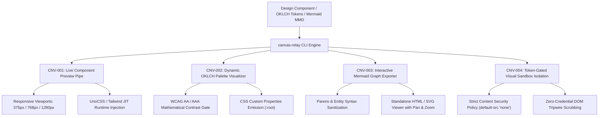

# canvas — Dynamic Visual Artifact Streaming & Canvas Relay Engine

> **Operating Role**: Jasper (Creative Technologist & Growth Mastermind) & Sol (Product Architect)  
> **Direct Triggers**: "design canvas", "canvas relay", "live component preview", "component preview pipe", "oklch visualizer", "mermaid export", "visual sandbox", "token-gated canvas", "stream visual artifact"  
> **Core Directives**: CNV-001 through CNV-004  

The `canvas` mode bridges generative AI coding and visual design fidelity. It streams live UI components, interactive OKLCH design token palettes, and Mermaid architectural diagrams into a CSP-isolated visual canvas sandbox, providing instant client previews without manual deployment cycles.

---

## The 4 Core Invariants (CNV-001 – CNV-004)



---

### CNV-001: Live Component Preview Pipe

Eliminate blind code generation. `canvas-relay` instantly renders generated UI components into a responsive preview harness:

1. **Multi-Viewport Real-Time Simulation**:
   - Generates isolated viewports for Mobile (375px), Tablet (768px), and Desktop (1280px).
   - Allows evaluating media queries, typography scale, and responsive grid collapse.
2. **PostMessage Hot-Swap Bridge**:
   - Implements a bi-directional event listener (`type: 'CANVAS_UPDATE'`) allowing real-time hot-reloading of inner HTML without destroying iframe state or reloading network bundles.
3. **Runtime Utility Injection**:
   - Dynamically injects UnoCSS runtime for instant Tailwind v4 class evaluation without requiring local build compilation.

---

### CNV-002: Dynamic OKLCH Palette Visualizer

Perceptually uniform color is standard in modern design systems:

1. **Mathematical Contrast Verification**:
   - Evaluates lightness ($L$) and relative luminance contrast against light ($L \approx 0.98$) and dark ($L \approx 0.12$) canvas surfaces.
   - Enforces WCAG compliance: **AA** ($\ge 4.5:1$) and **AAA** ($\ge 7.0:1$) for all text and interactive accent tokens.
2. **Instant Design Token Export**:
   - Generates production-ready CSS custom properties block (`:root { --color-primary: oklch(...); }`) compatible with Tailwind/UnoCSS configurations.

---

### CNV-003: Interactive Mermaid Graph Exporter

Architectural diagrams communicate complex workflows to clients and teams:

1. **Syntax Hazard Prevention**:
   - Audits against common syntax pitfalls: unquoted parentheses inside node brackets (e.g. `id["Label (Extra)"]`), illegal unescaped HTML characters (`<`, `>`), and missing graph headers.
2. **Standalone Interactive Viewer**:
   - Bundles the Mermaid source into a standalone HTML viewer powered by Mermaid.js CDN with clean neutral styling and cross-browser zoom support.

---

### CNV-004: Token-Gated Visual Sandbox Isolation

Rendering dynamic HTML poses security and data leakage risks:

1. **Strict Content Security Policy (CSP)**:
   - Enforces `default-src 'none'; style-src 'unsafe-inline' https://cdn.jsdelivr.net; script-src 'unsafe-inline' https://cdn.jsdelivr.net; img-src 'self' data: https:;`.
   - Prevents unauthorized external network fetches, tracking beacons, and script exfiltration.
2. **DOM Credential Scrubbing Tripwire**:
   - Audits markup for leaked API keys (`sk-*`, `ghp_*`, private keys). If detected, triggers an immediate security alert and halts preview rendering.

---

## 🛠️ CLI Usage & Practical Workflows

```bash
# 1. Generate live responsive preview for a component
bun skills/agency-delivery/design/scripts/canvas-relay.ts \
  --preview-component \
  --input hero-section.html \
  --viewport mobile \
  --output preview.html

# 2. Audit an OKLCH color palette for WCAG contrast compliance
bun skills/agency-delivery/design/scripts/canvas-relay.ts \
  --audit-palette \
  --input palette.json

# 3. Validate and export an interactive Mermaid architectural diagram
bun skills/agency-delivery/design/scripts/canvas-relay.ts \
  --export-mermaid \
  --input architecture.mmd \
  --output graph-viewer.html

# 4. Audit an exported canvas page for CSP fences and credential leaks
bun skills/agency-delivery/design/scripts/canvas-relay.ts \
  --audit-sandbox \
  --input preview.html
```

---

## 📊 Quality Verification Checklist

Before presenting any visual canvas artifact to a client:
- [ ] Responsive viewport preview verified at 375px mobile and 1280px desktop (CNV-001).
- [ ] OKLCH color palette meets minimum WCAG AA contrast on both light and dark backgrounds (CNV-002).
- [ ] Mermaid diagrams pass syntax validation with quoted labels and valid headers (CNV-003).
- [ ] CSP meta header verified and zero credential tokens exposed in DOM (CNV-004).
